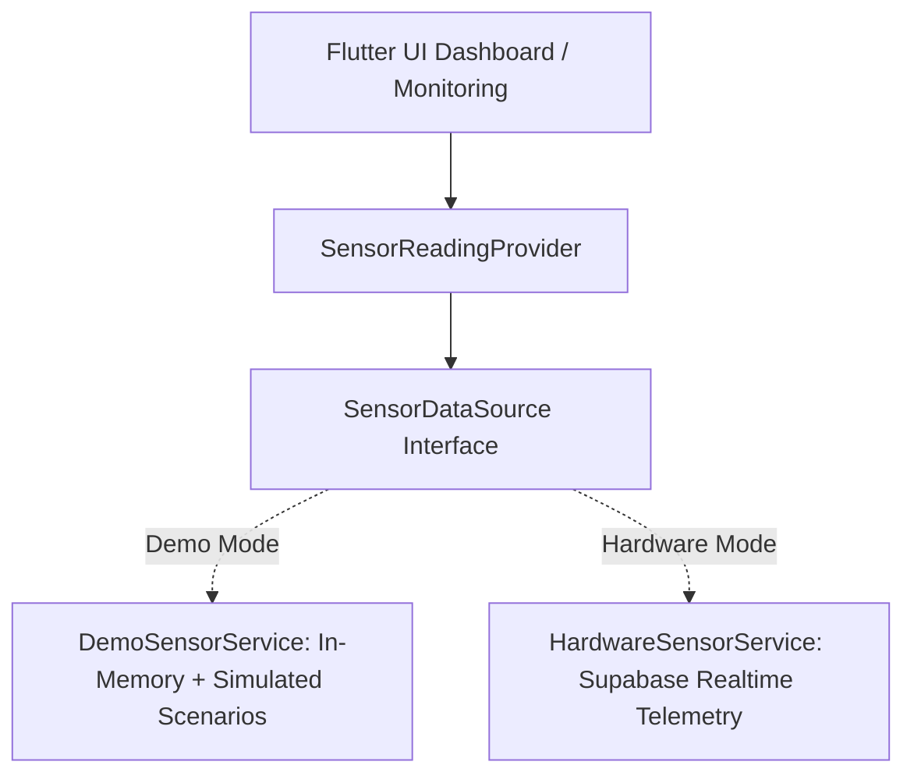

# Architecture Specification — MediGuard

## 1. Architectural Principles

MediGuard adheres to Clean Architecture with a **feature-first** layout:

```
lib/
  main.dart                      # App entry point, bootstrap, initialization
  app.dart                       # MaterialApp.router, theme configuration, route observer
  core/
    config/                      # SupabaseConfig, AppConstants, Environment
    theme/                       # AppTheme, AppColors, AppTypography, AppRadius
    routing/                     # AppRouter, ShellRoute, Navigation guards
    errors/                      # Failure types, exceptions, error handling
    utils/                       # DateFormatters, Formatters, Unit conversion
    widgets/                     # StatusBadge, MetricCard, AppEmptyView, ErrorView
  data/
    models/                      # Medicine, SensorReading, Alert, Transaction, DeviceSettings
    services/                    # SupabaseService, NotificationService, DemoSensorService, HardwareSensorService
    repositories/                # MedicineRepository, SensorRepository, AlertRepository, TransactionRepository, SettingsRepository
  features/
    auth/                        # LoginScreen, RegisterScreen, ForgotPasswordScreen, AuthState
    home/                        # HomeScreen, DashboardHeader, CompartmentCards, QuickActions
    inventory/                   # InventoryScreen, MedicineDetailScreen, AddEditMedicineScreen, TransactionFlowScreen
    monitoring/                  # MonitoringScreen, EnvironmentalCharts, SensorHealthCard
    alerts/                      # AlertsScreen, AlertItemCard, AlertFilterChips
    history/                     # HistoryScreen, ActivityTimelineItem, EventFilter
    settings/                    # SettingsScreen, ProfileSection, ThresholdSettingsScreen, SimulationControlsScreen
  shared/
    providers/                   # Global Riverpod providers, connectivity, theme providers
    widgets/                     # AppScaffoldWithNavBar, DemoModeBanner, ConnectionStatusChip
```

---

## 2. Unidirectional Data Flow

1. **UI Layer (Widgets)**: Purely consumes state from Riverpod providers. Listens to user interactions and delegates actions to Notifiers/Controllers. No direct SQL or Supabase calls inside widgets.
2. **State Layer (Riverpod Notifiers & Streams)**:
   - Evaluates business rules (e.g. alert threshold breaches, inventory status transitions).
   - Manages optimism, error handling, and loading states.
3. **Repository Layer**:
   - Single source of truth for features.
   - Encapsulates database calls, serialization, validation, and cache policies.
4. **Data Source / Service Layer**:
   - `SupabaseService`: Wraps Postgrest, GoTrue, and Realtime channels.
   - `SensorDataSource`: Pluggable abstraction implemented by `DemoSensorService` (simulation engine) and `HardwareSensorService` (Supabase Realtime device stream).
   - `NotificationService`: Handles local OS alert notifications.

---

## 3. Sensor Data Abstraction & Transition



### Safety Guarantees:
- Every reading holds a `data_source` property (`DataSourceType.simulated` or `DataSourceType.hardware`).
- Demo mode displays a persistent visual indicator: **DEMO MODE — SIMULATED DATA**.
- Sensor readings are never fabricated as hardware.

---

## 4. Alert Deduplication Engine

Alerts must not trigger continuously on every sensor tick (e.g., 3-second simulation timer):
1. **State Transition Detection**: An alert is generated ONLY when a threshold crosses from valid to out-of-bounds (e.g., Normal -> High Temp).
2. **Active Alert Index**: If an active alert of the same type and compartment already exists, new sensor ticks update in-memory telemetry without spawning duplicate database rows.
3. **Auto-Resolution**: When the temperature returns to the configured safe range for 2 consecutive cycles, the active alert can transition to `resolved` status with an audit timestamp.

---

## 5. Recoverable Inventory Transactions

Medicine inventory updates adhere to strict two-phase atomic semantics:
1. **Pending Stage**:
   - Medicine is marked `pending_add` or `pending_remove`.
   - Transaction row inserted with status `pending`.
2. **Confirmation Stage**:
   - User verifies compartment placement.
   - Database function `confirm_inventory_transaction` executes atomically with row locking.
   - If user cancels, the transaction is marked `cancelled` and inventory remains intact.
